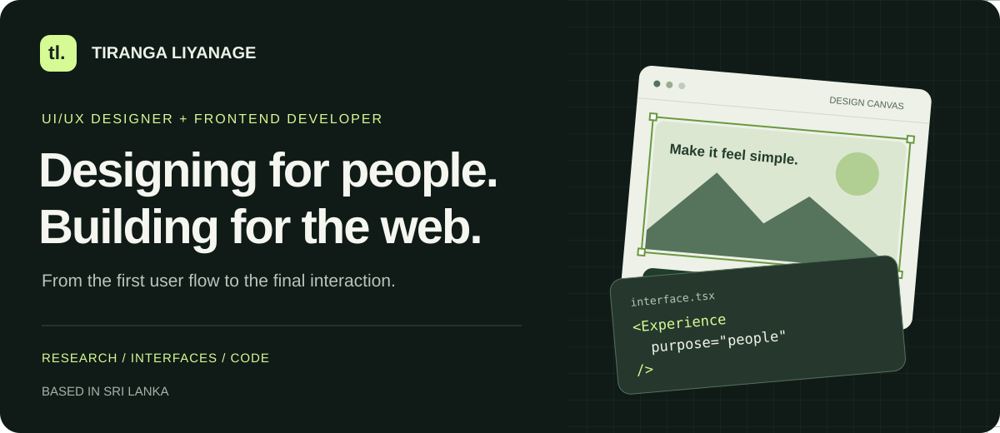
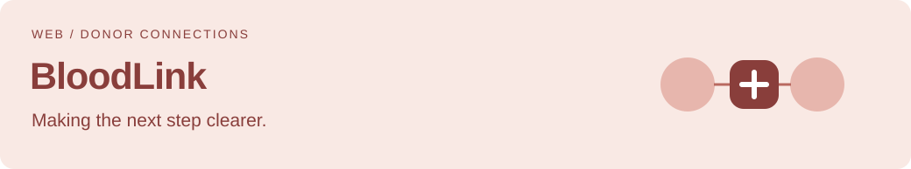

  

  <a href="#selected-work">Selected work</a> &nbsp; / &nbsp;
  <a href="#how-i-work">How I work</a> &nbsp; / &nbsp;
  <a href="https://www.linkedin.com/in/tiranga-liyanage/">LinkedIn</a> &nbsp; / &nbsp;
  <a href="mailto:tirangaliyanage@gmail.com">Let's talk</a>

## Hi, I'm Tiranga.

**UI/UX designer and frontend developer based in Sri Lanka.** I turn complex tasks into clear user flows, thoughtful interfaces, and working experiences.

My interests sit where design meets development: understanding what people need, making the next action easy to find, and carrying that thinking into the code.

## Selected work

**Splitting trip expenses without the awkward spreadsheet.** My HCI case study explores item-level attribution and participation windows, so shared costs reflect who took part. The Flutter app repository focuses on transparent payers, shares, and settlements.

[Explore Tally →](https://github.com/Tira2003/Tally)

 

**Helping donors and people requesting blood find their next step.** A React frontend with donor registration, blood requests, matching-request views, and donation camps. The interface uses calm surfaces and reserves urgency cues for the moments that need them.

`React` · `Tailwind CSS` · `shadcn/ui` · `Motion`

[Explore the frontend →](https://github.com/Tira2003/BloodLink-Frontend)

 

**Making solar performance easier to understand.** A responsive dashboard for monitoring panel performance, spotting anomalies, and managing invoices, with interactive charts and reusable UI components.

`React` · `Redux Toolkit` · `Tailwind CSS` · `Recharts`

[Explore the frontend →](https://github.com/Tira2003/Solar_FE) · [Live demo →](https://fed-4-front-end-tirangaliyanage.netlify.app/)

### Also on my design desk: Findly

An iOS travel app concept for discovering hidden local places in Sri Lanka. The design brings together **information freshness, community routes, parking and arrival guidance, and responsible place visibility** to help travelers decide with more confidence.

## How I work

| Understand | Design | Build & refine |
| :--- | :--- | :--- |
| Start with the user, their context, and the task. | Map flows, explore wireframes, and prototype interactions in Figma. | Translate interfaces into components, review usability, and refine the details. |

I care about **visual hierarchy, clear feedback, and the small decisions that make an interface easier to use**.

## My toolkit

**Design** &nbsp; Figma · User flows · Wireframing · Prototyping · Usability testing  
**Frontend** &nbsp; JavaScript · TypeScript · React · Next.js · Tailwind CSS  
**Supporting skills** &nbsp; Node.js · Java · Spring Boot · Python · Git · Docker

---

### Have a product challenge in mind?

I'm interested in UI/UX and frontend opportunities where I can help shape the experience and bring it to life.

**[Connect on LinkedIn ↗](https://www.linkedin.com/in/tiranga-liyanage/)** &nbsp; · &nbsp; **[Email me ↗](mailto:tirangaliyanage@gmail.com)**

Thoughtful interfaces. Clear interactions. Built with purpose.

